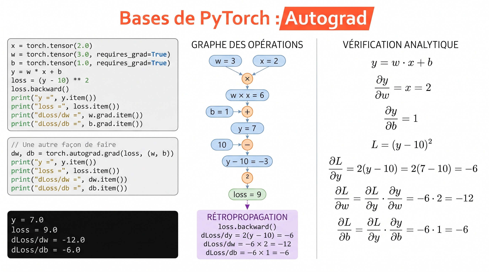
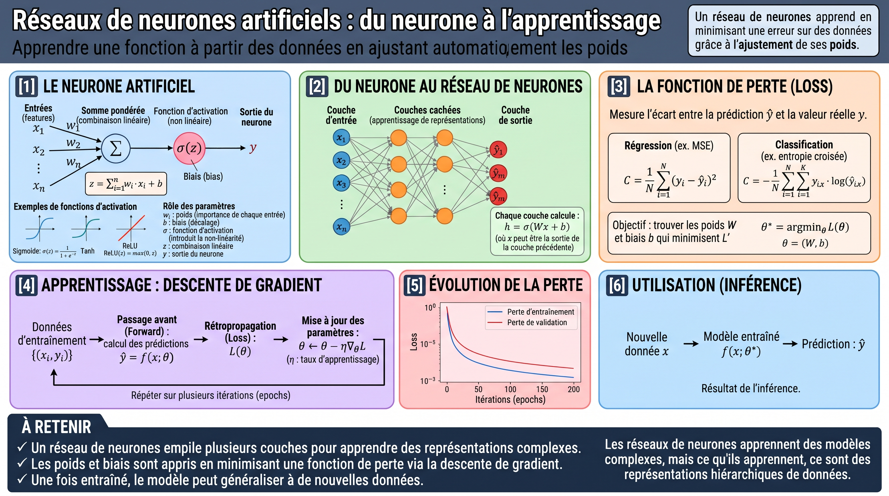
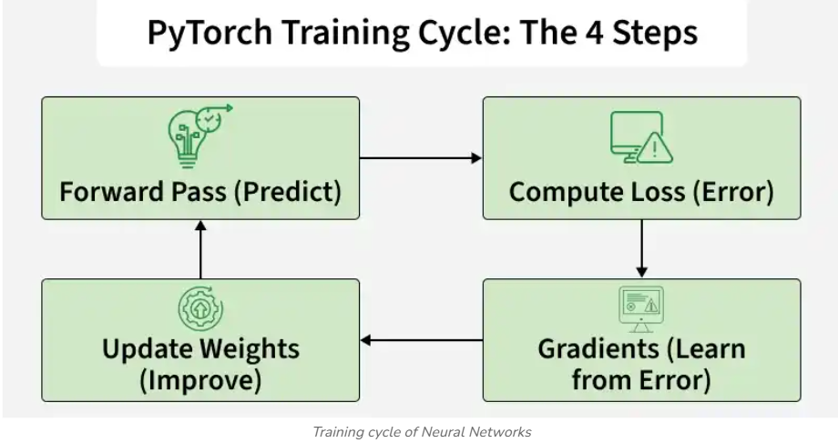

# Introduction à PyTorch : des tenseurs aux réseaux de neurones

Notebook d'initiation à PyTorch : tenseurs, Autograd, régression linéaire, classification et MLP.

📓 **Notebook :** [`Introduction_PyTorch_Tenseurs_Regression_Classification.ipynb`](Introduction_PyTorch_Tenseurs_Regression_Classification.ipynb)

---

## 1. Autograd : le calcul automatique des gradients

PyTorch construit un **graphe de calcul** pendant le forward pass, puis `loss.backward()` le parcourt à l'envers pour calculer les dérivées. Ici, avec `y = w·x + b` et `loss = (y − 10)²`, on retrouve bien à la main `dLoss/dw = −12` et `dLoss/db = −6`.

## 2. Le réseau de neurones

Un neurone calcule une somme pondérée de ses entrées puis applique une fonction d'activation. En empilant plusieurs couches, le réseau apprend des représentations complexes. L'apprentissage consiste à **minimiser une fonction de perte** (MSE pour la régression, entropie croisée pour la classification) en ajustant les poids.

## 3. Le cycle d'entraînement

Chaque epoch répète les mêmes 4 étapes, que l'on retrouve dans les boucles du notebook :

| Étape | Code PyTorch |
|---|---|
| Forward pass (prédire) | `y_pred = model(x)` |
| Calcul du loss (erreur) | `loss = loss_function(y_pred, y)` |
| Gradients (apprendre de l'erreur) | `optimizer.zero_grad()` puis `loss.backward()` |
| Mise à jour des poids (s'améliorer) | `optimizer.step()` |

